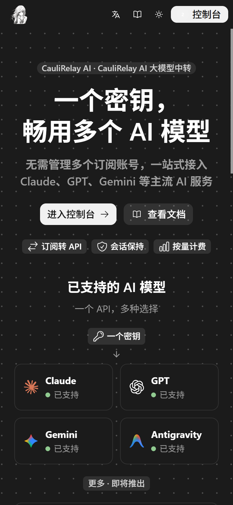
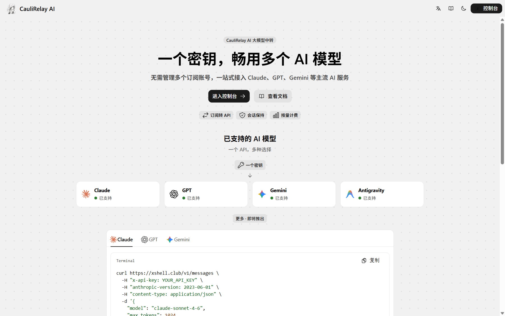
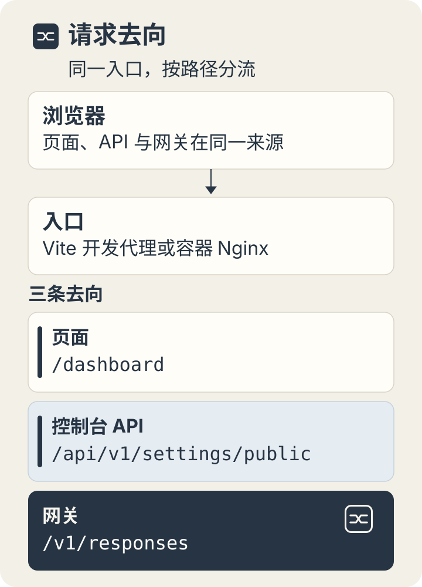

# Sub2API Astryx

Sub2API 换上了清爽的 Astryx 新前端。下面是 CauliRelay AI 正式站的实际画面。

## 手机端

<p align="center">
  <a href="./assets/readme/mobile-home.webp"></a>
</p>

<details>
<summary>查看桌面首页 · 浅色主题</summary>

[](./assets/readme/desktop-home.webp)

</details>

## 本地启动

准备一个开发机能访问的 Sub2API 后端，默认地址为 `http://localhost:8080`。使用 Node.js 22.13 或更新的 22.x，或使用 Node.js 24 及以上版本。仓库锁定了 pnpm 12.4.2。后端安装步骤见 [Sub2API 上游仓库](https://github.com/Wei-Shaw/sub2api) · [package.json](./package.json)

```sh
git clone https://github.com/feiwell/sub2api-astryx.git
cd sub2api-astryx
npm install --global pnpm@12.4.2
pnpm install --frozen-lockfile
pnpm dev
```

打开 `http://localhost:3100`。再打开 `http://localhost:3100/api/v1/settings/public`，应看到后端的公开设置 JSON。后端不在默认地址时，把 `.env.example` 复制为 `.env.local`（PowerShell 用 `Copy-Item .env.example .env.local`），改 `VITE_DEV_PROXY_TARGET` 后重新运行 `pnpm dev`。[.env.example](./.env.example)

## 开发

| 命令 | 用途 |
| --- | --- |
| `pnpm typecheck` | 检查 TypeScript |
| `pnpm test` | 跑一遍前端测试。改代码时用 `pnpm test:watch` |
| `pnpm build` | 检查 TypeScript 类型并生成前端构建产物 `dist/` |
| `pnpm preview` | 本地预览 `dist/`，默认端口为 `4173`。API 和网关请求沿用开发代理 |

先运行 `pnpm build`，再用 `pnpm preview` 查看构建结果。预览服务通过 `VITE_DEV_PROXY_TARGET` 连接后端。要验证生产环境的转发、缓存和 CSP，请使用下方的 Nginx 容器。[vite.config.ts](./vite.config.ts)

持续集成在 Ubuntu 上使用 Node.js 22.x，按 `package.json` 安装锁定的 pnpm，再执行冻结锁文件安装、类型检查、测试、构建，并用构建好的 `dist/` 做镜像配置检查。[.github/workflows/ci.yml](./.github/workflows/ci.yml)

## 使用 Docker 部署

先在仓库根目录生成 `dist/`，再构建 Docker 镜像。镜像打包 `dist/`、Nginx 配置和 nonce 脚本。基础镜像是 `nginx:1.30-alpine`（带 njs），进程以 `nginx` 用户监听容器内 `8080`。[Dockerfile](./Dockerfile) · [.dockerignore](./.dockerignore)

```sh
pnpm install --frozen-lockfile
pnpm build
docker build -t sub2api-astryx:local .
```

后端已经在 Docker 网络里时，前端容器加入该网络，`SUB2API_UPSTREAM` 填网络内的 `服务名:端口`。下面假设网络名是 `sub2api-net`，后端服务名是 `backend`，容器内端口是 `8080`。端口映射绑在本机回环地址上。[deploy/site.conf.template](./deploy/site.conf.template)

```sh
docker run --rm --network sub2api-net -p 127.0.0.1:3100:8080 -e SUB2API_UPSTREAM=backend:8080 sub2api-astryx:local
```

后端跑在宿主机上时，使用 Docker 的宿主机网关。Linux 上的后端需要监听容器能够访问的宿主机地址。启动后打开 `http://localhost:3100`。[Dockerfile](./Dockerfile)

```sh
docker run --rm -p 127.0.0.1:3100:8080 --add-host=host.docker.internal:host-gateway -e SUB2API_UPSTREAM=host.docker.internal:8080 sub2api-astryx:local
```

`SUB2API_UPSTREAM` 接受内网 HTTP 后端的 `host:port`。对外提供 HTTPS 时，在入口终止 TLS，保留浏览器看到的 `Host`，并用 `-e SUB2API_PUBLIC_SCHEME=https` 启动前端容器。后端收到的 `X-Forwarded-Proto` 就是这个值。回调地址使用同一个公开 HTTPS 源，在后端和服务商控制台里配成同一个源。模板默认把 `X-Real-IP` 和 `X-Forwarded-For` 写成直连地址，并清掉 `Forwarded`。后端若按来源 IP 限流，要在入口和 Nginx 里另行配置受信代理网段。容器启动时只会替换 `SUB2API_UPSTREAM` 和 `SUB2API_PUBLIC_SCHEME`。[deploy/site.conf.template](./deploy/site.conf.template)

## 浏览器路由与网关转发

<p align="center">
  
</p>

刷新 `/dashboard` 时，服务器返回 `index.html`，React 再根据登录状态和后端设置显示页面。控制台 API 和模型网关直接使用后端响应。下表列出部署示例的转发与缓存规则。[src/router/index.tsx](./src/router/index.tsx) · [scripts/devProxy.ts](./scripts/devProxy.ts)

| 浏览器或客户端请求 | 处理方式 |
| --- | --- |
| `/`、`/dashboard`、`/admin/*`、`/setup` | React 路由。刷新时返回 `index.html` |
| `/auth/callback`、`/auth/oidc/callback`、`/auth/wechat/payment/callback`、`/payment/result`、`/oauth/mcp/authorize` | 浏览器回跳或授权确认页，进入 SPA |
| `/api/v1/*`、`/setup/*` 接口、`/health` | 原路径转发给后端。`/setup` 页面本身仍是 SPA |
| `/api/v1/auth/oauth/*/callback`、`/api/v1/payment/webhook/*` 等 | 发给后端，保留方法、查询、正文和签名头 |
| `/v1/*`、`/v1beta/*`、`/backend-api/codex/*`、`/antigravity/*`，以及 `/models`、`/responses`、`/chat/completions`、`/images/generations` 等根路径 | 发给网关，保留后端状态码并实时转发流式响应 |
| `/api/v1/admin/ops/ws/qps`、`/v1/responses` 等 WebSocket | 转发 HTTP Upgrade，并保留 `Sec-WebSocket-Protocol` |
| `/licenses/`、`/licenses/*` | 提供构建时随包分发的许可文件。缺失文件返回 404 |
| `/assets/*` | 带内容哈希的构建资源，可长期缓存。缺失文件返回 404 |
| `/logo.svg` 及其他静态文件 | 按扩展名返回，缓存策略为 `no-cache`。缺失文件返回 404 |

例如，OIDC 身份提供方把浏览器送到后端的 `/api/v1/auth/oauth/oidc/callback`。后端处理完，再把浏览器送到前端的 `/auth/oidc/callback`。支付服务商把签名通知发到 webhook，付款用户回到 `/payment/result`。[deploy/site.conf.template](./deploy/site.conf.template)

运维 QPS 使用 `/api/v1/admin/ops/ws/qps`。`VITE_WS_BASE_URL` 为空时它跟随 API 所在来源。单独填写时只写 `host[:port]`，页面是 HTTPS 就用 `wss`。入口为 WebSocket 握手转发 Upgrade 头，并为网关的流式 HTTP 响应关闭缓冲。[src/lib/api/admin/ops.ts](./src/lib/api/admin/ops.ts) · [deploy/nginx.conf](./deploy/nginx.conf)

## 环境变量

将 `VITE_*` 视为公开配置。后端密钥、OAuth 客户端密钥和支付凭据保存在后端。[.env.example](./.env.example)

| 变量 | 默认行为 |
| --- | --- |
| `VITE_DEV_PROXY_TARGET` | 开发和本地预览使用的后端源地址。默认为 `http://localhost:8080`，格式为协议、主机和可选端口 |
| `VITE_DEV_PORT` | `pnpm dev` 的默认端口为 `3100` |
| `VITE_API_BASE_URL` | 默认 `/api/v1`，供控制台业务 API 使用。网关地址去掉 `/api/v1` 后缀，并保留来源和已有的路径前缀 |
| `VITE_WS_BASE_URL` | 留空时运维 WebSocket 跟随 API 来源。指定主机时使用 `host[:port]` 格式 |
| `VITE_DEFAULT_SITE_NAME` | 后端还没返回自定义站名时显示 `Sub2API` |
| `VITE_PREVIEW_BUILTIN_HOME` | 默认 `false`，沿用后端配置的首页。旧站点若配了自定义首页，在 `.env.local` 写 `true` 并重新构建，才显示 Astryx 内置首页 |

前两项配置本地 Vite 服务。后四项在构建时写入浏览器产物，修改后需重新运行 `pnpm build`。使用容器部署时，再用新的 `dist/` 构建镜像。[vite.config.ts](./vite.config.ts) · [shared/api/url.ts](./shared/api/url.ts)

## 高级运维

示例 Nginx 用 njs 为每一次 HTML 响应生成 16 字节（128 位）随机数，再编码成 base64。同一个值写进 CSP 的 `nonce-` 和主题初始化脚本的 `nonce` 属性。构建产物里只放占位符 `__CSP_NONCE_VALUE__`。这条 HTML 响应带 `Cache-Control: no-store`。CDN 要保留该策略，只长期缓存带哈希的 `/assets/`。[deploy/nonce.js](./deploy/nonce.js) · [index.html](./index.html)

示例 CSP 默认从同源加载脚本，并限制对外部服务的连接。启用第三方验证码、支付 SDK 或外部自定义首页时，把实际域名加进对应的 `script-src`、`connect-src`、`frame-src` 等指令，并保留脚本 nonce。模板在 `connect-src` 中放行当前页面主机的 `ws` 和 `wss`。单独指定 WebSocket 主机时，也要把该主机加进去。CSP 写在模板里，改完要重新构建镜像。[deploy/site.conf.template](./deploy/site.conf.template)

启用 Airwallex 时，`/payment/airwallex` 会按需从官方 CDN 加载 SDK。在模板的 `script-src` 加入 `https://static.airwallex.com`，再按所用支付环境补上 SDK 需要的网络和 iframe 来源，然后重新构建镜像。付完款的人回到本站 `/payment/result`。[Airwallex 托管收银台](https://www.airwallex.com/docs/payments/online-payments/hosted-payment-page/guest-user-checkout) · [Airwallex JS SDK](https://www.airwallex.com/docs/js)

发布包使用通用登录控件。启用 Google 登录前，先按官方品牌指南配置按钮并核对展示要求。[Sign in with Google Branding Guidelines](https://developers.google.com/identity/branding-guidelines)

## 许可证

本仓库以 LGPL-3.0-or-later 发布。`LICENSE` 保留上游文本，`COPYING.LESSER` 是 GNU LGPL 第 3 版，`COPYING` 是 LGPL 所纳入的 GNU GPL 第 3 版。上游由来和修改说明见 `NOTICE`。[LICENSE](./LICENSE) · [NOTICE](./NOTICE) · [COPYING.LESSER](./COPYING.LESSER)

仓库提供源代码和 CI 配置，部署方可以按上文构建镜像。构建之后可以打开站点的 `/licenses/` 阅读随包许可，直接地址是 `/licenses/THIRD_PARTY_NOTICES.md` 和 `/licenses/bundled-dependencies.md`。分发修改过的构建时，保留这些文件，并向接收者提供该构建对应的完整源码和构建脚本，例如链接到该版本的源码归档或 Git 提交。[前端源码](https://github.com/feiwell/sub2api-astryx) · [项目许可](./LICENSE) · [第三方许可说明](./THIRD_PARTY_NOTICES.md)
